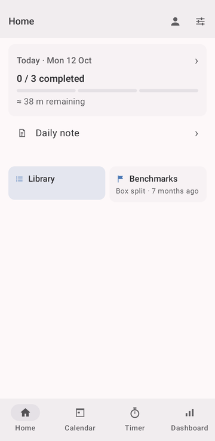
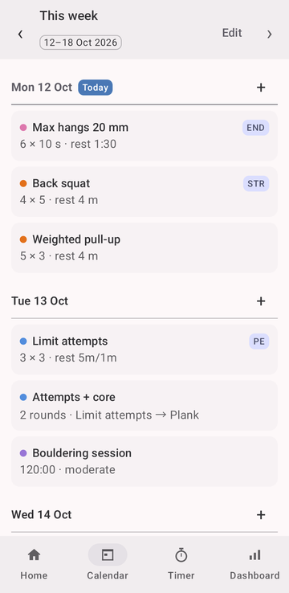
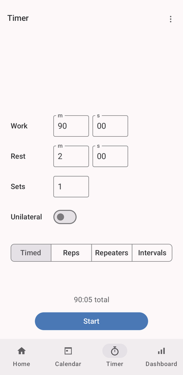
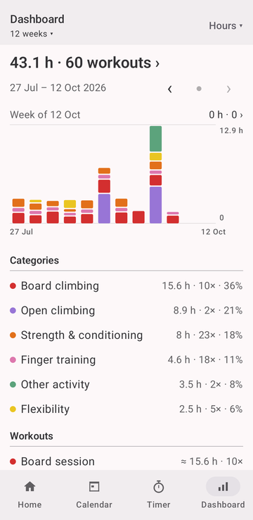
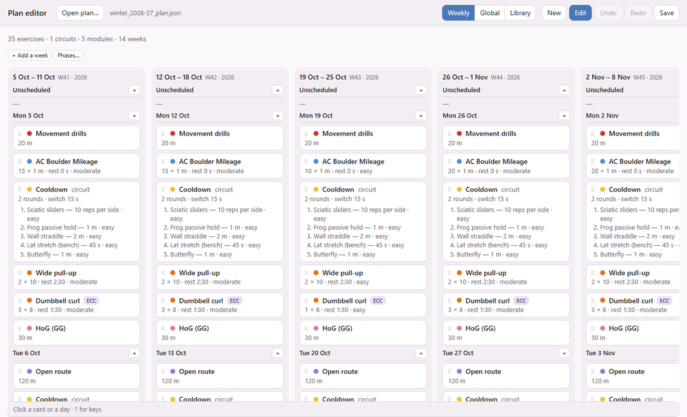

# Melete

Melete is a personal Android app for climbing training: climbing itself, finger strength, lifting and mobility, all in one week.

I made it because I wanted to follow my own plans and keep a useful record without filling in Excel sheets or wasting three hours sifting through notes. It’s opinionated because it’s built around my own training, but I’m sharing it here in case it’s useful to someone else.

Melete takes a lot of inspiration from the Lattice Training app, which I think is excellent. It just didn’t quite fit what I wanted to include in my training or how I wanted to plan it.

   

## How I use it

The calendar holds the plan: individual exercises, circuits, reusable modules, or just a climbing session. Exercises have their own prescriptions and variations. Modules let me organise things I often plan together; circuits handle exercises performed in rounds. A scheduled copy can be adjusted without changing the library template.

During training, I can open an exercise, see what I did last time, use its timer and log the result. There’s no need to start a whole workout first. Logging can be detailed per set, including left/right loads, or kept brief when I don’t feel like entering everything. The timer covers timed sets, reps, repeaters and intervals, with audio cues and support for circuits and unilateral work.

Daily notes and custom trackers keep things like energy, finger discomfort and bodyweight alongside the training. Benchmarks have their own history, separate from completed training. The dashboard and graphs are also there for motivation: seeing the work add up and progress over time helps me keep going. Exercise history lets me look back at what I actually did.

For planning a whole season, there’s also a [browser-based plan editor](tools/plan-viewer/index.html). Open it locally, edit the weeks and library, then import the file into Melete. The [plan format](docs/plan-format.md) is documented if you prefer writing or generating the file yourself. The app works offline, and the whole record can be exported as a backup.

AI can help with both the app and the planning. The project is documented in [`docs/`](docs/) so an AI coding agent can pick it up and help build or adapt it. You can also give an AI the plan format and your training outline to get a quick draft, then review and adjust it in the plan editor before importing.



## Building

Android Studio, or:

```
./gradlew :app:installRelease    # "Melete", the everyday app
./gradlew :app:installDebug      # "Melete Debug", for development
./gradlew :app:testDebugUnitTest
```

Debug and release have separate data: [build guide](docs/debug-release.md). Built with Kotlin, Jetpack Compose and Room, with help from Claude Code. More detail in the [project notes](docs/build-status.md).
